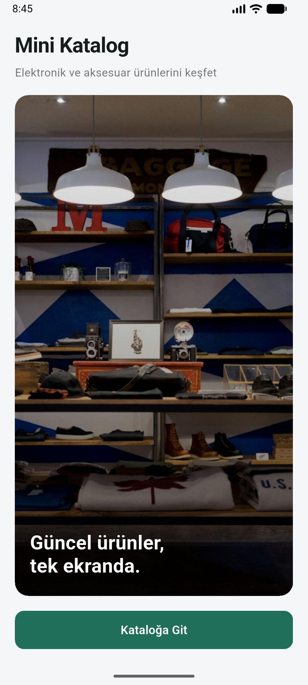
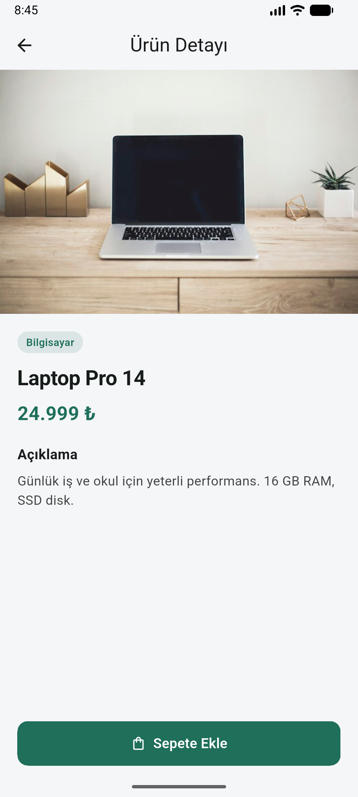

# Mini Katalog

Flutter ile geliştirilmiş basit bir ürün kataloğu uygulaması.

Ana sayfa → ürün listesi (GridView) → ürün detayı akışı var. Sepete ekleme `setState` ile simüle ediliyor. Veriler yerel JSON dosyasından okunuyor; ekstra paket kullanılmıyor.

## Kullanılan Flutter sürümü

```
Flutter 3.47.7
Dart 3.13.5
```

Kontrol için:

```bash
flutter --version
```

## Çalıştırma adımları

```bash
git clone https://github.com/Utkkku/mini_katalog.git
cd mini_katalog
flutter pub get
flutter run
```

Android emülatör veya fiziksel cihaz bağlı olmalı. Belirli cihaz için:

```bash
flutter devices
flutter run -d <device_id>
```

## Ekran görüntüleri

| Ana sayfa | Ürün listesi | Ürün detayı |
|:---------:|:------------:|:-----------:|
|  |  |  |

## Özellikler

- Named routes ile sayfa geçişleri (`Navigator`)
- Route arguments ile ürün detayına veri taşıma
- `GridView` + kart tabanlı ürün listesi
- JSON asset okuma (`fromJson` / `toJson`)
- `Image.asset` ile görsel yönetimi
- Arama / filtreleme
- Sepete ekleme (`setState`)

## Proje yapısı

```
lib/
  main.dart
  app.dart
  models/product.dart
  data/product_repository.dart
  screens/
    home_screen.dart
    product_list_screen.dart
    product_detail_screen.dart
    cart_screen.dart
  widgets/product_card.dart
assets/
  data/products.json
  images/
screenshots/
```

## Notlar

- Sadece Flutter Material kullanıldı (`pubspec.yaml` içinde ek dependency yok).
- Ürünler: `assets/data/products.json`
- Görseller: `assets/images/`
